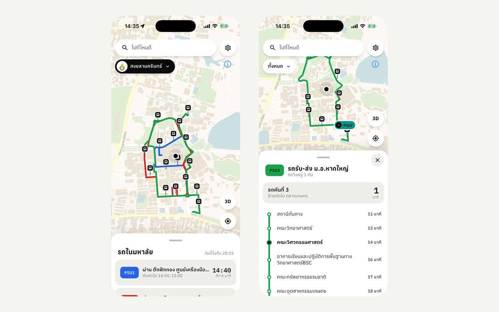
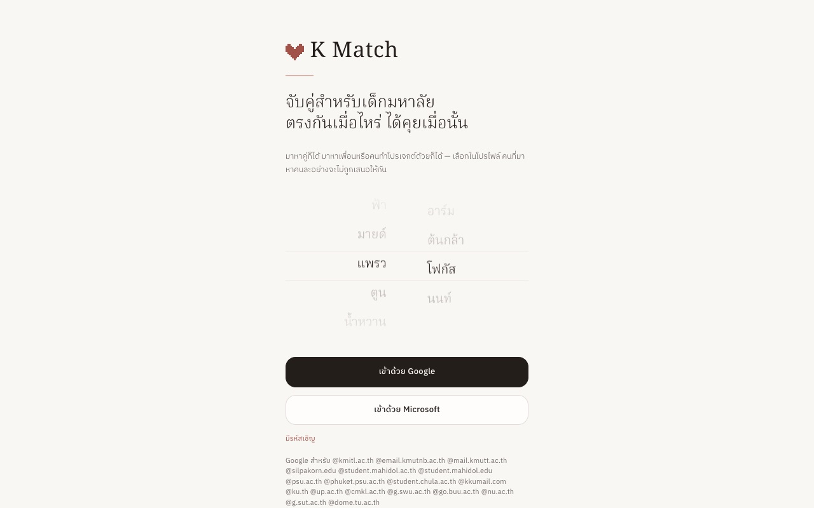
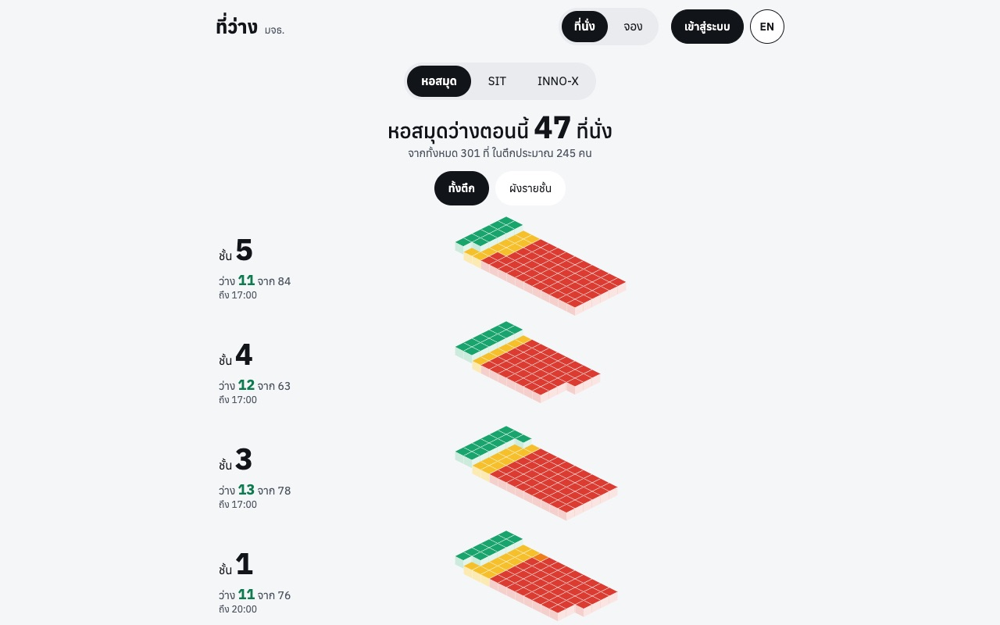
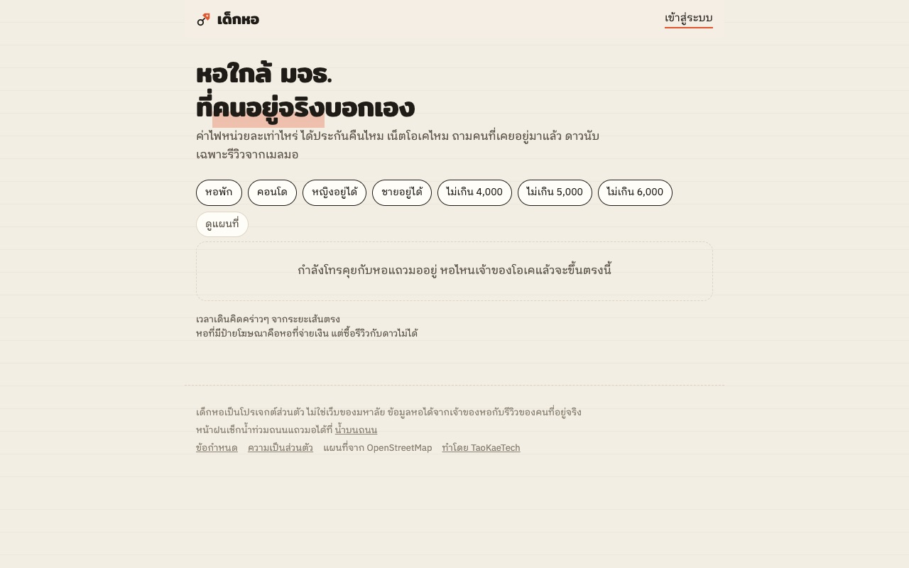
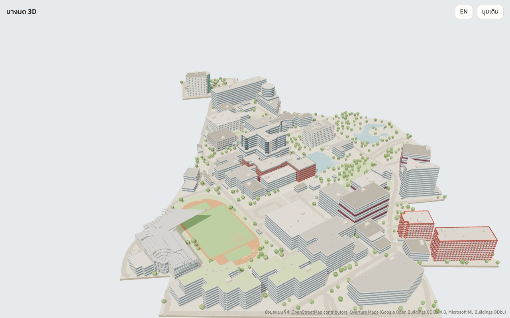
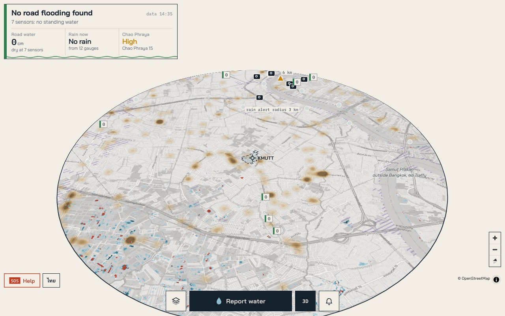

I'm Tayakorn, a first-year IT student at KMUTT in Bangkok. I also take freelance work through Fastwork and my own site, TaoKaeTech. Most of what I build is in daily use, either by a small business or by students on campus. I handle the whole job: the hardware if there is any, the server, the web or mobile app, and keeping it running after launch.

## Tools

## Projects

Most of the code is in private repos. Every project below has a live site you can open.

<table>
<tr>
<td width="50%" valign="top">

<h3><a href="https://rttransit.com">RTT</a></h3>
Live tracking for songthaews, vans and campus shuttles. Each vehicle carries an ESP32 GPS box that reports its position to my server. Riders see where the vehicles are, the stops on each route and arrival times on the web. A mobile app is in testing. Arrival times are based on how fast each route actually runs at that hour.
  <code>ESP32</code> <code>Python</code> <code>Svelte</code> <code>Flutter</code>
</td>
<td width="50%" valign="top">

<h3><a href="https://kmatch.taokaetech.com">KMatch</a></h3>
A matching app for university students in Thailand. You choose up to five people a day, and a match depends on writing real messages to each other instead of swiping. Sign-in uses university email only. There is a web app, an iOS app on the App Store, and a paid pass sold through PromptPay.
  <code>Next.js</code> <code>TypeScript</code> <code>SQLite</code> <code>Flutter</code>
</td>
</tr>
<tr>
<td width="50%" valign="top">

<h3><a href="https://teewang.taokaetech.com">Teewang</a></h3>
Library seat map and study room booking for KMUTT, plus booking for maker-space machines. Students sign in with their university Microsoft account. Devices such as 3D printers report their status through an open API. Available in Thai and English.
  <code>Next.js</code> <code>TypeScript</code> <code>SQLite</code>
</td>
<td width="50%" valign="top">

<h3><a href="https://dekhor.taokaetech.com">Dekhor</a></h3>
A dorm finder for students near KMUTT. It lists electricity rates, deposits and internet quality, with reviews from people who actually lived there. Only reviews from university email accounts count toward the rating. Includes a map view with walking times.
  <code>Next.js</code> <code>Auth.js</code> <code>MapLibre</code> <code>SQLite</code>
</td>
</tr>
<tr>
<td width="50%" valign="top">

<h3><a href="https://bangmod3d.taokaetech.com">Bangmod 3D</a></h3>
A 3D model of the KMUTT Bang Mod campus that runs in the browser, built from OpenStreetMap and Overture building data. Room status comes from Teewang. The same model was printed as a 1:1500 physical model.
  <code>three.js</code> <code>Python</code> <code>OpenStreetMap</code>
</td>
<td width="50%" valign="top">

<h3><a href="https://flood.taokaetech.com">FloodWatch</a></h3>
Road flooding within 6 km of KMUTT on one map. It combines Bangkok's road water sensors, rain gauges, the Chao Phraya water level, reports from people and satellite flood layers. It can send push alerts and has an SOS button for anyone stuck in a flood.
  <code>Python</code> <code>MapLibre</code> <code>Web Push</code>
</td>
</tr>
</table>

## Client work

These were built for paying clients. I've left out client names.

- **Billing system for an egg farm.** Creates invoices and makes a monthly summary that separates good eggs from off-grade eggs. Invoices print correctly from an iPhone or iPad, and the database is backed up off-site every day. `FastAPI` `SQLite` `Docker`
- **Payroll and attendance for a company.** Imports clock-in data from the time clock scanners, supports two shifts a day and calculates pay. Comes with LINE bots: staff request cash advances there, admins approve them, and there is a KPI log for each employee. `FastAPI` `React` `PostgreSQL` `LINE Messaging API`
- **Employee training records.** Keeps every course each employee has taken, imports past records from old Excel files and exports reports. `FastAPI` `openpyxl` `Docker`
- **Cargo status updater.** A Windows program that replaced an Excel macro. It reads tracking numbers from the sheet, gets their status from three China to Thailand cargo websites, and writes the results back. `Python` `Windows .exe`
- **Prize game kiosk.** A Raspberry Pi box with a big timer display. Players press a button to stop the clock, and stopping at exactly 05.67 wins. Handles the button, relay and sound through GPIO. Built for an event. `Raspberry Pi` `Python`
- **Auto shipping for online shops.** Books shipments automatically for 16 shops on Pancake POS, so nobody has to do it by hand each morning. `Python` `Docker`

Side projects: [Taeklued](https://taeklued.taokaetech.com) (menus and prices for canteens and cafes at PSU Hat Yai) and [AR Detect](https://tayakorn000.github.io/ar-detect) (object detection from a webcam in the browser, including zero-shot search with OWLv2).

## Activity

<picture>
  <source media="(prefers-color-scheme: dark)" srcset="profile/stats-dark.svg" />
  
</picture>
<picture>
  <source media="(prefers-color-scheme: dark)" srcset="profile/top-langs-dark.svg" />
  
</picture>

<picture>
  <source media="(prefers-color-scheme: dark)" srcset="profile/streak-dark.svg" />
  
</picture>

<picture>
  <source media="(prefers-color-scheme: dark)" srcset="profile/snake-dark.svg" />
  
</picture>
